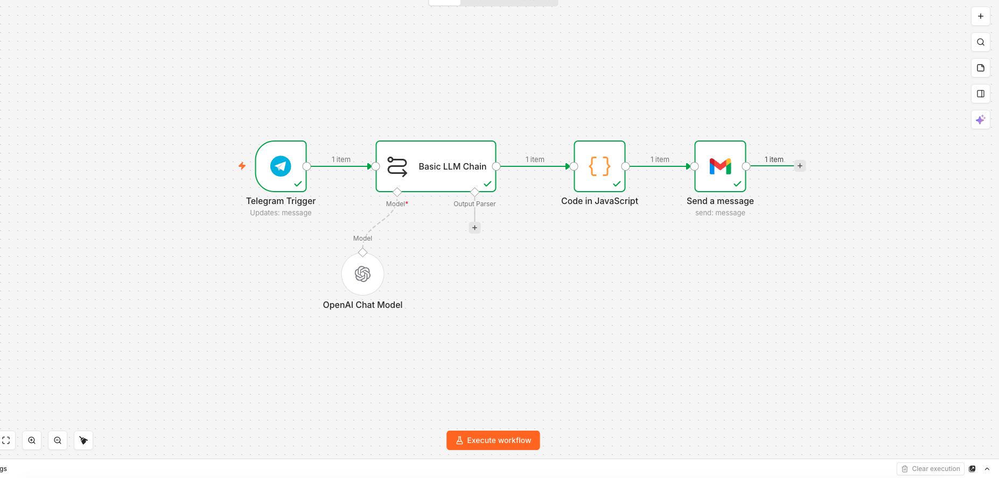

# API + AI Automation: Slack, Telegram & Gmail

Three small automations that connect an LLM to everyday messaging apps, built two ways: **n8n** (no-code) and **plain Python**.

| Automation | Built with | What it does |
| --- | --- | --- |
| **Slack Recipe Bot** | Python (`slack_python_automation.py`) | Ask for a dish; GPT returns an ingredient list for 4 people and posts it to a Slack channel |
| **Slack Recipe Bot** | n8n (`n8n_Slack_Recipe_bot.json`) | The same flow as a no-code workflow |
| **Telegram → Gmail** | n8n (`API_AI_Telegram_Gmail_automation.json`) | Send a short request on Telegram; the LLM drafts a personalised email and sends it through Gmail |



## Run the Python bot

```bash
pip install -r requirements.txt
cp .env.example .env     # add SLACK_BOT_TOKEN, OPENAI_API_KEY, SLACK_CHANNEL_ID
python slack_python_automation.py
```

Your Slack app needs the `chat:write` scope and must be invited to the channel.

## Import the n8n workflows

**Workflows → Import from File**, then add OpenAI, Slack, Telegram and Gmail credentials to the nodes.

## Tech stack

Python · slack_sdk · OpenAI Responses API · n8n · Telegram Bot API · Gmail API
